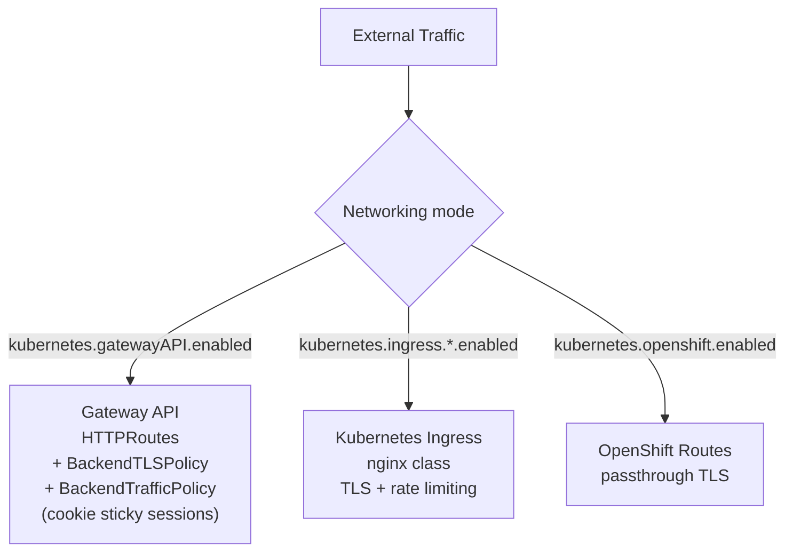
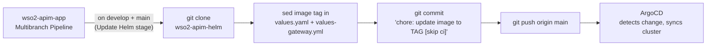

# wso2-apim-helm

**Helm chart deploying WSO2 API Manager 4.7.0 (all-in-one) on Kubernetes, and the GitOps source of truth for the project.**

> Part of the [apim-gitops](https://github.com/apim-gitops) project. This repo is
> the **deploy** step:
> [wso2-apim-app](https://github.com/apim-gitops/wso2-apim-app) builds the image
> and commits its tag here → **wso2-apim-helm** → ArgoCD syncs the cluster.
> Releases are cut by [ci-app-pipelines](https://github.com/apim-gitops/ci-app-pipelines).

This repository is the **GitOps source of truth**: the CI pipeline in
`wso2-apim-app` updates the image tags here on `develop` and `main` builds, and
ArgoCD reconciles the target cluster with what is committed here. Nothing is
deployed by hand.

---

## Table of Contents

- [Repository Structure](#repository-structure)
- [What It Deploys](#what-it-deploys)
- [Networking](#networking)
- [Configuration](#configuration)
- [Multi-Cloud Support](#multi-cloud-support)
- [How It's Updated](#how-its-updated)

---

## Repository Structure

```
wso2-apim-helm/
├── README.md
└── wso2-chart/
    ├── Chart.yaml                          # Chart metadata (name: wso2am-all-in-one, ver: 4.7.0-2)
    ├── values.yaml                         # Primary values (image tag updated by CI)
    ├── values-gateway.yml                  # Alternate values (custom sab4r/wso2am-custom image)
    ├── my-values.yaml                      # Deployment-specific overrides
    ├── default_values.yaml                 # Reference values (fully commented, H2 defaults)
    ├── default_openshift_values.yaml       # Reference values for OpenShift
    ├── confs/
    │   ├── api-manager.sh                  # WSO2 Carbon startup script
    │   ├── log4j2.properties               # Log4j2 configuration template
    │   ├── secret-conf.properties          # Secure vault template
    │   ├── wso2.crt                        # CA certificate (self-signed, localhost)
    │   ├── instance-1/deployment.toml      # Static TOML for instance 1
    │   ├── instance-2/deployment.toml      # Templated TOML for instance 2 (HA mode)
    │   └── frontend-confs/
    │       ├── admin-settings.json         # Admin portal settings
    │       ├── devportal-settings.json     # DevPortal settings
    │       └── publisher-settings.json     # Publisher settings
    └── templates/
        ├── _helpers.tpl                    # Go template helpers
        ├── NOTES.txt                       # Post-install instructions
        └── am/
            ├── wso2am-service.yaml         # Aggregate Service (all instances)
            ├── wso2am-pdb.yaml             # PodDisruptionBudget (minAvailable: 50%)
            ├── instance-1/
            │   ├── wso2am-deployment.yaml  # Primary Deployment
            │   ├── wso2am-service.yaml     # Instance-1-specific Service
            │   └── wso2am-conf.yaml        # deployment.toml ConfigMap
            ├── instance-2/
            │   ├── wso2am-deployment.yaml  # HA Deployment (gated by highAvailability)
            │   ├── wso2am-service.yaml     # Instance-2-specific Service
            │   └── wso2am-conf.yaml        # deployment.toml ConfigMap
            ├── *-ingress.yaml              # Kubernetes Ingress resources
            ├── *-route.yaml                # OpenShift Route resources
            ├── *-httproute.yaml            # Gateway API HTTPRoute resources
            ├── *-storageclass.yaml         # Storage classes (AWS, GCP)
            ├── *-volume.yaml               # PersistentVolume resources
            ├── *-volume-claims.yaml        # PersistentVolumeClaim resources
            ├── secrets/                    # CSI Secret Store providers
            └── ConfigMaps (entrypoint, log4j2, secret-conf, script, settings, CA cert)
```

---

## What It Deploys

### Core workloads

| Resource | Replicas | Strategy | Notes |
|---|---|---|---|
| **Deployment (instance 1)** | 1 | Recreate | Always deployed |
| **Deployment (instance 2)** | 1 | Recreate | Only when `wso2.deployment.highAvailability: true` |
| **PodDisruptionBudget** | minAvailable 50% | n/a | Covers all instances |

### All-in-one architecture

All WSO2 APIM profiles run in a single container:

| Component | Role | Port |
|---|---|---|
| Publisher | API design and lifecycle management | 9443 |
| DevPortal | Developer portal for API discovery and subscription | 9443 |
| Admin Portal | Administration of tenants, users and settings | 9443 |
| Gateway | API traffic (pass-through) | 8243, 8280 |
| Key Manager | OAuth2 and token issuance | 9443 |
| Traffic Manager | Throttling and rate limiting | 9443 |
| Control Plane | Central management, Carbon console | 9443 |

> The Publisher, DevPortal, Admin, Key Manager, Traffic Manager and Control
> Plane are served by the same Carbon HTTPS listener, so they share port 9443.
> The Gateway has its own listeners (8243 HTTPS, 8280 HTTP).

The pods run the custom image built by
[`wso2-apim-app`](https://github.com/apim-gitops/wso2-apim-app#docker-build)
(`sab4r/wso2am-custom`), which carries the branded Publisher, DevPortal and Admin UIs.

### Exposed ports

| Port | Protocol | Purpose |
|---|---|---|
| 9443 | HTTPS | Management (Publisher, DevPortal, Admin, Carbon Console) |
| 8243 | HTTPS | API Gateway pass-through |
| 8280 | HTTP | API Gateway pass-through |
| 9611 | TCP | Binary transport |
| 9711 | TCP | Binary secure transport |
| 5672 | TCP | JMS |
| 9099 | HTTP/WS | Websocket |
| 9021 | HTTP | Websub callbacks |

### Probes

| Probe | Type | Endpoint | Key params |
|---|---|---|---|
| **Startup** | TCP check | Port 9443 | initialDelay: 30s, failureThreshold: 30 |
| **Liveness** | HTTP GET | `/services/Version` (port 9763) | initialDelay: 120s, period: 30s |
| **Readiness** | HTTPS GET | `/api/am/gateway/v2/server-startup-healthcheck` (port 9443) | initialDelay: 30s, period: 10s |

---

## Networking

The chart supports **three mutually exclusive** traffic routing strategies:



| Endpoint | Hostname (default) | Port |
|---|---|---|
| Management | `am.wso2.com` | 9443 |
| Gateway | `gw.wso2.com` | 8243 |
| Websocket | `websocket.wso2.com` | 9099 |
| Websub | `websub.wso2.com` | 9021 |

Each endpoint is independently configurable per strategy (enabled/disabled,
hostname, annotations, filters).

---

## Configuration

### Values files

| File | Purpose | Updated by |
|---|---|---|
| `values.yaml` | Primary default values | CI pipeline (image tag only) |
| `values-gateway.yml` | Gateway API variant with the custom `sab4r/wso2am-custom` image | CI pipeline (image tag only) |
| `my-values.yaml` | Deployment-specific overrides | Manual |
| `default_values.yaml` | Reference: fully documented defaults with H2 database | Manual |
| `default_openshift_values.yaml` | Reference: OpenShift-specific defaults | Manual |

### Key configuration categories

| Category | Key properties |
|---|---|
| **Image** | `wso2.deployment.image.registry`, `.repository`, `.tag`, `.pullPolicy` |
| **HA** | `wso2.deployment.highAvailability` creates a second Deployment |
| **Resources** | `wso2.deployment.resources.requests/limits` (CPU/memory), JVM `xms`/`xmx` |
| **Database** | `wso2.apim.configurations.databases`: type (mysql/oracle/mssql/postgres/h2), URLs, pool params |
| **Security** | `wso2.apim.configurations.security`: JKS keystores, truststore, existing K8s secret refs |
| **Gateway** | `wso2.apim.configurations.gateway`: environments, endpoints, hostnames |
| **Auth** | Admin credentials, OAuth, JWT, CORS, ISKM |
| **Analytics** | ELK, Moesif, OpenTracing, OpenTelemetry |
| **Frontend** | `wso2.apim.mountFrontendConfig` enables settings.json ConfigMaps for all portals |
| **Secure Vault** | `wso2.apim.secureVaultEnabled` + CSI Secret Store (AWS/Azure/GCP) |

> Runtime configuration (datasources, user stores, identity providers) lives
> here, in the values files. It is deliberately **not** part of the image
> (`wso2-apim-app`), and production secrets are never committed: they are
> referenced from a secrets manager (see [Multi-Cloud Support](#multi-cloud-support)).

### Image tag update points

The CI pipeline updates the image tag in two files with `sed`:

```
wso2-chart/values.yaml          →  sed 's|tag:.*|tag: <new_tag>|'
wso2-chart/values-gateway.yml   →  sed 's|tag:.*|tag: <new_tag>|'
```

Tag formats: [Image tagging](https://github.com/apim-gitops/wso2-apim-app#image-tagging).

> Note: this repository needs a custom Docker registry account to push your image. To deploy, please modify `values file` :

```yml
  deployment:
    # Configure High Availability
    highAvailability: false
    # Container image configurations
    image:
      # -- Container registry credentials.
      # Specify image pull secrets for private registries
      imagePullSecrets:
        enabled: false
        # -- Name of an existing image pull secret in the namespace. If set, this secret is used directly and no new secret is created.
        name: "" # Docker image (see `wso2-apim-app`, Credentials section)
        username: "changeme" # Docker Registry username
        password: "changeme" # Docker Registry PAT
      # -- Registry containing the image
      registry: "docker.io"
      # -- Repository name consisting the image
      repository: "changeme"
      # -- Docker image tag
      tag: 4.7.0_0.4.0-SNAPSHOT-b09ca567a # This line will be modified automatically by the Jenkins pipeline in `wso2-apim-app`
      # -- Refer to the Kubernetes documentation on updating images (https://kubernetes.io/docs/concepts/containers/images/#updating-images)
      imagePullPolicy: IfNotPresent
```

---

## Multi-Cloud Support

| Cloud | Storage | Secrets | Service Account |
|---|---|---|---|
| **AWS** | EFS (StorageClass + PV + PVCs) | Secrets Manager (CSI SecretProviderClass) | IRSA |
| **Azure** | Azure Files (PV + PVCs) | Key Vault (CSI SecretProviderClass + Service Principal) | Azure AD |
| **GCP** | FileStore (StorageClass + PV + PVCs) | Secret Manager (CSI SecretProviderClass) | Workload Identity |

Each cloud provider is enabled with its own `aws.enabled`, `azure.enabled` or
`gcp.enabled` flag.

---

<a id="how-its-updated"></a>
## How It's Updated

This repo is never edited by hand to ship a new version. The `wso2-apim-app`
pipeline commits the new image tag, and ArgoCD deploys it.



### Update flow

1. A build succeeds on `develop` or `main` in
   [`wso2-apim-app`](https://github.com/apim-gitops/wso2-apim-app#ci-pipeline)
   and the image is pushed to Docker Hub.
2. The **Update Helm** stage clones this repo, rewrites the `tag:` in
   `values.yaml` and `values-gateway.yml`, and commits
   `chore: update image to <tag> [skip ci]`.
3. It pushes to `main`. `[skip ci]` prevents the commit from triggering any
   other pipeline.
4. ArgoCD detects the new commit and syncs the cluster, which rolls out the
   new image.

`release/*` and `hotfix/*` builds push an image to Docker Hub but **do not**
update this repo, so release candidates are never deployed automatically.

### Branch model

This repo uses a **single branch** (`main`). Unlike `wso2-apim-app`, it does
not follow Gitflow: every commit on `main` is what ArgoCD deploys.

| Image built from | Tag written here | Intended environment |
|---|---|---|
| `develop` | `4.7.0_0.5.0-SNAPSHOT-<sha>` | Staging |
| `main` | `4.7.0_0.4.0` | Production |

> **TODO: decide and document.** Both builds write the same `tag:` field of the
> same files on the same branch, so staging and production overwrite each
> other. Pick one and document it here:
> - **Per-environment values files** (e.g. `values-staging.yaml`,
>   `values-production.yaml`), each with its own `tag:` and its own ArgoCD
>   Application, and teach the *Update Helm* stage to target the right file; or
> - **A single environment**, in which case describe it as such and drop the
>   staging/production wording from the other repos.
